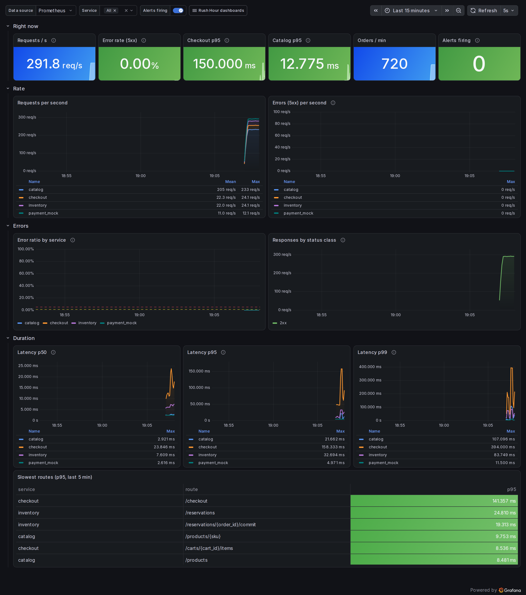

# Rush Hour

[](https://github.com/omaraldulimay/rush-hour/actions/workflows/ci.yml)

▶ **Try it in the browser:** [interactive demo on my portfolio](https://omaraldulimay.github.io/projekte/rush-hour.html#demo)

Platform behind a fictional fashion shop (Nordkai Fashion) that is built to survive a Black Friday
night. Design and goals: [docs/architecture.md](docs/architecture.md). This repository currently
contains steps 1-3: five services, migrations, seed data, docker compose, tests, CI and a Helm chart
for Kubernetes (kind) with autoscaling and PgBouncer.

Services: `catalog`, `inventory`, `checkout`, `payment_mock`, `order_worker` (Python 3.12, FastAPI,
asyncpg, Redis).

## Run

```sh
make up      # postgres, redis, migrate + seed (one-shot), then all services
make down    # stop and delete volumes
```

| Service | Host port |
|---|---|
| catalog | 8001 |
| inventory | 8002 |
| checkout | 8003 |
| payment-mock | 8004 |
| order-worker (ops endpoints only) | 8005 |
| control-room (UI), prometheus, grafana, alertmanager | 8080, 9090, 3000, 9093 |

No Docker? `make local` runs everything as plain processes (Postgres, Redis, Prometheus, the services
and the Control Room at http://localhost:8080): [docs/local.md](docs/local.md).

Without Docker, by hand: set `DATABASE_URL` and `REDIS_URL`, then
`python -m libs.common.migrate && python -m scripts.seed` and
`uvicorn services.<name>.app.main:create_app --factory`.
`make seed` re-runs migrate + seed against a running stack (idempotent; live stock is kept,
`python -m scripts.seed --reset-stock` restores seeded levels).

## Run on Kubernetes

Needs Docker, [kind](https://kind.sigs.k8s.io), kubectl and Helm 3. The images are the same ones compose builds.

```sh
kind create cluster --name rush-hour --config deploy/kind/cluster.yaml   # 1 control plane + 2 workers
for s in catalog inventory checkout payment-mock order-worker; do
  docker build -t ghcr.io/omaraldulimay/rush-hour/$s:dev --build-arg SERVICE=${s//-/_} .
  kind load docker-image ghcr.io/omaraldulimay/rush-hour/$s:dev --name rush-hour
done
# metrics-server is needed for the HPAs (kind needs --kubelet-insecure-tls, see ci.yml)
helm upgrade --install rush-hour deploy/helm/rush-hour -f deploy/helm/rush-hour/values-ci.yaml \
  --set image.tag=dev --wait --atomic --timeout 8m
./scripts/smoke.sh          # services are on localhost:8001-8005 (NodePorts)
kubectl get pods,hpa
kind delete cluster --name rush-hour
```

The chart is in `deploy/helm/rush-hour`. Postgres and Redis run in the cluster only for the demo
(`postgres.enabled=false` + `database.host` / `redis.enabled=false` + `redis.externalUrl` switch them off).
The database password is generated on first install and kept across upgrades; or pass
`database.existingSecret`. Details: [docs/architecture.md](docs/architecture.md#kubernetes).

For AWS, [`infra/aws`](infra/aws/README.md) describes EKS, RDS and ElastiCache in Terraform (validated in CI, never applied) and how its outputs feed these chart values.

## Test

```sh
make install
make lint
make test
```

Tests need no Docker. Without `DATABASE_URL` they start a throwaway Postgres cluster
(`initdb` + `pg_ctl` from `/Library/PostgreSQL/16/bin`, override with `PG_BIN`) on a free port and
delete it afterwards. Redis is `fakeredis` unless `REDIS_URL` is set.

## CI

`.github/workflows/ci.yml` runs on every push to `main`, every pull request and on demand.

| Job | What it proves |
|---|---|
| `lint` | `ruff check` and `ruff format --check` are clean |
| `test` | The whole suite passes against real Postgres 16 and Redis 7 (service containers), not just fakeredis |
| `build` | All five images build; on `main` they are pushed to `ghcr.io/omaraldulimay/rush-hour/<service>` as `sha-<short>` and `main` |
| `scan` | Trivy finds no fixable CRITICAL/HIGH vulnerabilities in any image; results go to code scanning |
| `smoke` | The stack started from the just-built images works end to end (`scripts/smoke.sh`: browse, cart, checkout, paid order, stock decreased, `/metrics`) |
| `chart` | `helm lint --strict` and `helm template \| kubeconform -strict` pass (with and without the in-cluster data tier) |
| `k8s` | A kind cluster (1 control plane + 2 workers) runs the chart with the just-built images: migration hook, PgBouncer, `scripts/smoke.sh`, then a k6 load burst. kube-prometheus-stack runs next to it: SLO recording rules must have data and be within target during the load, then `payment-mock` is taken down and `PaymentBreakerOpen` must fire and resolve again (timeline in the job summary). Grafana and Control Room screenshots are uploaded as an artifact. The HPAs must scale `catalog` above its minimum; one catalog pod is deleted under load. The replica/CPU table and the error rates are in the job summary |
| `terraform` | `terraform fmt -check`, `init -backend=false`, `validate` and `trivy config` (HIGH/CRITICAL) on `infra/` |
| `observability` | `promtool check` and `promtool test rules`: every SLO rule and alert is unit-tested with its real `for:` durations |
| `sign` (main) | Each pushed image has an SPDX SBOM attestation and a keyless cosign signature that is verified against this workflow's identity; only runs if the images also survived Kubernetes (`k8s`) |

## Game day

A 6-minute sale night on kind, run by [`gameday.yml`](.github/workflows/gameday.yml) (manual and weekly, not on every push): warm-up, the midnight spike, a **bad release of checkout during the spike**, a **slow payment provider**, cool-down. Checkout is an Argo Rollouts canary (20 % → 50 % → 100 %) that Prometheus checks; the bad release (`FAULT_ERROR_RATE=0.5`, same image) is aborted and rolled back on its own.

| | Result |
|---|---|
| Peak load | 262 requests/s, 696 orders/min |
| Bad release | aborted after 44 s, back on stable after 45 s, 6.9 % of checkouts in that window failed |
| Payment slow | breaker open 65 s, 543 pending orders, 0 left in the retry queue afterwards |
| Oversold units | **0** |
| SLOs | catalog availability and latency met; checkout availability (98.09 %) and latency (98.39 %) missed because of the two incidents |
| Cost | about $0.0012 per 1,000 orders (CPU-seconds x an assumed vCPU price) |

Full report with timeline and honest limits: [docs/gameday/report.md](docs/gameday/report.md) ([workflow run](https://github.com/omaraldulimay/rush-hour/actions/runs/42099479303)).

## Observability

SLOs, burn-rate alerts, runbooks and four Grafana dashboards (shop overview, SLOs, sale night, data tier): [docs/architecture.md#observability](docs/architecture.md#observability). Grafana runs in compose (http://localhost:3000), with `make local` and in the k8s CI job.



Action versions are pinned to commit SHAs; Dependabot updates them weekly (plus pip and Docker).

## Endpoints

Every service: `GET /healthz`, `GET /readyz`, `GET /metrics`.

**catalog**
- `GET /products?category=&limit=&offset=`
- `GET /products/{sku}`

**inventory**
- `POST /reservations` `{order_id, items:[{sku, qty}]}` -> 201, 200 on replay, 409 `sold_out`
- `POST /reservations/{order_id}/release`, `POST /reservations/{order_id}/commit`
- `GET /stock/{sku}`

**checkout**
- `PUT /carts/{cart_id}/items` `{sku, qty}`, `GET /carts/{cart_id}`, `DELETE /carts/{cart_id}/items/{sku}`
- `POST /checkout` `{cart_id}` with optional `Idempotency-Key` header
- `GET /orders/{order_id}`

**payment-mock**
- `POST /payments` `{order_id, amount_cents}` -> `{status: paid|declined}` (503 on injected error)
- `POST /payments/{order_id}/refund` -> `{status: refunded}` (idempotent; 404 unknown, 409 declined, same fault injection)
- `GET|POST /admin/fault` `{latency_ms, error_rate, decline_rate}`

**order-worker** has no business API; it consumes the Redis Stream `orders`.

## Configuration

Environment variables only. The ones you will most likely touch: `DATABASE_URL`, `REDIS_URL`,
`CATALOG_URL`, `INVENTORY_URL`, `PAYMENT_URL`, `PAYMENT_TIMEOUT_S` (2), `BREAKER_FAILURE_THRESHOLD`
(5), `BREAKER_WINDOW_S` (30), `BREAKER_COOLDOWN_S` (10), `PAYMENT_LATENCY_MS`, `PAYMENT_ERROR_RATE`,
`PAYMENT_DECLINE_RATE`, `WORKER_MAX_ATTEMPTS` (5), `RETRY_BASE_DELAY_S` (5), `CACHE_TTL_S` (30), `SWEEP_INTERVAL_S` (30), `STALE_CREATED_AFTER_S` (120),
`ORPHAN_PENDING_AFTER_S` (120), `SWEEP_BATCH_SIZE` (100). The sweeper repairs stale `created`/`payment_pending`/unreleased
orders and retries refunds (`order_worker_swept_total{action}`; refunds: `payment_refunds_total`).
`FAULT_ERROR_RATE` (checkout, 0; share of `/checkout` calls answered with a 500, the game day's bad release), `DB_STATEMENT_CACHE_SIZE` (100; 0 behind PgBouncer in transaction mode), `DB_POOL_MIN` (2), `DB_POOL_MAX` (10).
