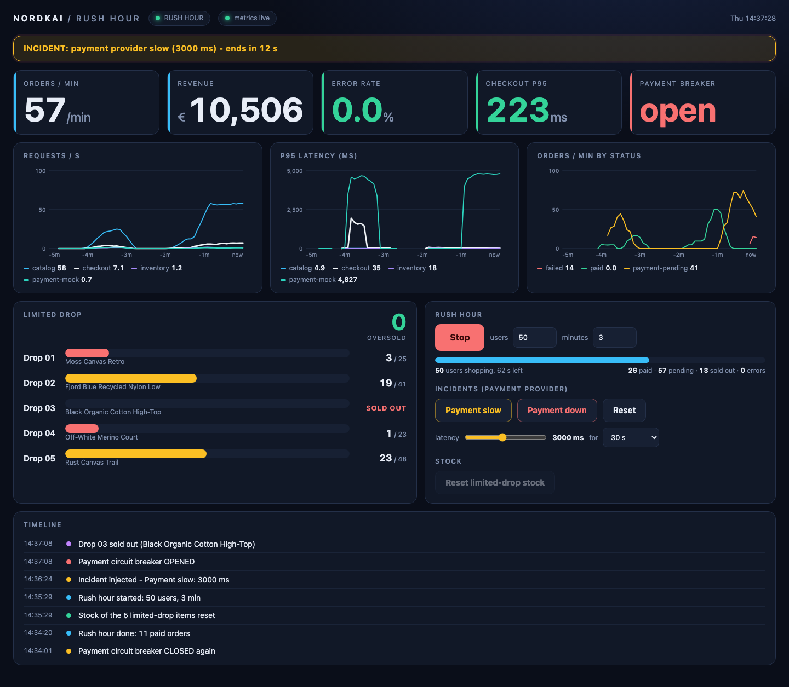

# Run everything on one machine, without Docker

```sh
make install        # once: .venv
make local          # start everything, wait for every /readyz, print the URLs
make local-status   # what is up
make local-stop     # stop everything (data is kept)
make local-reset    # stop and wipe the local database, Redis and Prometheus data
```

Open **http://localhost:8080** (the Control Room) and press *Start rush hour*.



| What | Where |
|---|---|
| Control Room (UI + demo admin API) | http://localhost:8080 |
| Prometheus | http://localhost:9090 |
| Grafana (4 dashboards, anonymous Viewer, admin / admin) | http://localhost:3000 |
| Alertmanager | http://localhost:9093 |
| catalog, inventory, checkout, payment-mock, order-worker | 8001, 8002, 8003, 8004, 8005 |
| Postgres 16 (own cluster, user/db `rushhour`) | 127.0.0.1:55432 |
| Redis | 127.0.0.1:56379 |

Everything binds to 127.0.0.1. The system Postgres on 5432 is never touched: the script only
runs `initdb`/`pg_ctl` against `.local/pg` (binaries from `PG_BIN`, default
`/Library/PostgreSQL/16/bin`).

## What `make local` does

`scripts/local/stack.py` keeps all state in `.local/` (git-ignored):

- `.local/pg` – Postgres cluster, persistent between runs. Migrations and the seed run on every
  start (idempotent; live stock is kept).
- `.local/redis`, `.local/prom` – data of Redis and Prometheus (2 h retention).
- `.local/bin/prometheus` – the official `darwin-amd64` release, downloaded once and verified
  against the release's `sha256sums.txt` (version pinned in the script).
- `.local/run/*.pid`, `.local/logs/<name>.log` – pid files and logs. Only processes whose pid file
  and command line match are ever stopped.
- The five services and the Control Room run as one uvicorn worker each, with the same environment
  variables as in `docker-compose.yml`. Prometheus uses
  `observability/prometheus/prometheus.local.yml` (scrape every 5 s).

Running `make local` twice is harmless: components that are up are left alone. A port that is
taken by a foreign process makes the script stop with an error instead of killing it.

Redis: the script uses `redis-server` or `valkey-server` if one is installed (also via
`REDIS_SERVER=/path`). If neither exists it runs `brew install valkey`. Valkey is the
Redis-compatible fork; Homebrew's `redis` formula needs llvm and rust, which do not build on an
Intel Mac without bottles. Set `REDIS_FORMULA=redis` to try the original anyway.

## The Control Room

`services/control_room` is a FastAPI service with a single-page UI (plain HTML/CSS/JS, inline SVG
charts, no build step, nothing loaded from a CDN).

- KPIs, charts and the event log read from Prometheus (PromQL); the limited-drop bars, the revenue
  and the **oversold** counter read the database in one consistent snapshot. Without Prometheus
  the UI shows "metrics offline" and keeps working.
- **oversold** = units reserved or sold beyond what was ever in stock + negative stock. It must
  be 0 – the invariant the project is built around.
- **Start rush hour** runs `scripts/rush.py` (90 % browse, 8 % cart, 2 % checkout, think time; a
  fifth of the users during warm-up, then everybody at once). It also runs from the CLI:
  `.venv/bin/python -m scripts.rush --users 50 --minutes 3`.
- **Incidents** call the payment mock's `POST /admin/fault`: *slow* (default 3000 ms, above the
  checkout's 2 s timeout, so the circuit breaker opens) or *down* (100 % errors), optionally
  reverting after 30 s / 2 min.
- **Reset stock** restores the five limited-drop items (not allowed during a run).

API: `GET /api/state`, `GET /api/series`, `POST /api/rush/start|stop`, `POST /api/fault`,
`POST /api/reset-stock`. It is a demo admin panel without authentication: it listens on localhost,
refuses cross-origin POSTs, and in Kubernetes it is a ClusterIP service (use `kubectl port-forward`).
Environment: `PROMETHEUS_URL`, `CATALOG_URL`, `CHECKOUT_URL`, `PAYMENT_URL`, `DATABASE_URL`.

## Grafana, alerts and rules

`make local` also starts Alertmanager and Grafana (official `darwin-amd64` tarballs, SHA-256 pinned in
`scripts/local/stack.py`, first start downloads about 500 MB). Prometheus loads
`observability/prometheus/rules/`. A Prometheus that is already running does not pick up the rules by itself:
run `make local-stop && make local` once. To start only Grafana and Alertmanager next to a running stack:
`.venv/bin/python -m scripts.local.stack observability`. Ports: `GRAFANA_PORT`, `ALERTMANAGER_PORT`.
